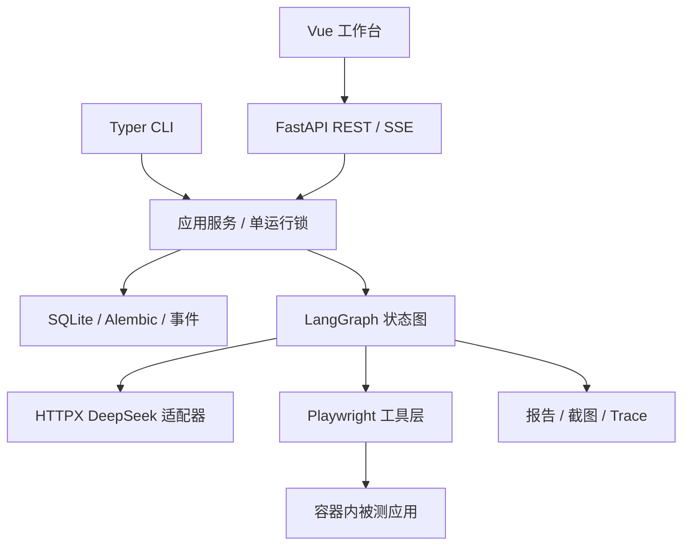

# 架构与约束

`schemas.py` 是共享领域契约；浏览器 Page/Context 与 HTTP client 由 Runner 管理，图状态只含可序列化数据。原始场景和应用配置在创建运行时复制，之后编辑场景不改变历史记录。

状态图 parse→plan→observe→verify→decide→execute→observe；请求结束时进入 finalize，重新观察并验证待完成检查点；执行失败进入 recover，再由决策选择恢复动作。初始页面导航也计数。达到预算后仍观察验证，工具层拒绝第 36 次操作。恢复和整体超时双重限制，观察/等待循环还有独立轮次上限。

检查点的 expected 由解析阶段固定；验证阶段只能更新状态、实际观察和证据编号。非 pending 结果要求引用存在的观察，并能在 ARIA 中找到所引原文。候选 PASS/FAIL 还需独立 evidence_audit 审查是否直接证明要求的页面/区域，不能把其他页面的共享导航当作目标页面证据。结束请求不替代验证；复核次数有限，证据不足仍为无法判定。模型语义判断仍需与人工标准答案对照。

运行状态 queued/running/completed/cancelled/interrupted/error 与测试结论 PASS/FAIL/INCONCLUSIVE 独立。取消/异常统一产生无法判定报告，保留已有证据。所有动作分发前增加步数，失败同样消耗预算。

事件以 SQLite 递增 sequence 保存。SSE 支持 after 与 Last-Event-ID；前端重新进入页面先读取历史，再订阅增量，并按序号去重。全局序号允许其他运行造成间隔。

模型密钥不经 API 返回；账号通过变量名解析为本机环境或 .env 中的值。模型只看到占位符；截图遮罩密码框。Trace 留在本地，可包含账号页面与网络信息。服务仅供可信本机使用，不具备多用户鉴权。

基础设施异常、模型 API 超时和无效结构化结果都不能当作应用 FAIL。当前模型使用独立验证调用，不依赖执行动作的自述作结论。对于复杂动态页面、拖拽和跨页验收，后续需要真实场景调优。
